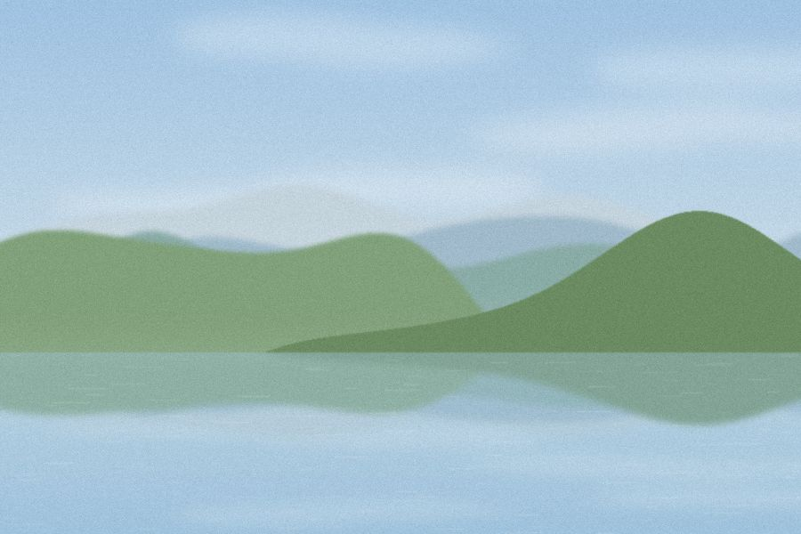

乘坐公交车穿梭在这座繁华都市的脉络之中，我不经意地望向窗外，发现今天的太阳格外明媚。

我向来喜欢在白日里编织梦想，有时连我自己都惊讶于这种能力——将自我与喧嚣的世界隔离，沉浸在自己的幻想之中。

时光荏苒，转眼一年已逝，那片泛着光芒的湖面，仿佛再次浮现在我的眼前。

梦继续延伸。我想象自己放下手头的工作，回到那片美丽的湖畔，在碧空如洗的草原上寻找一处静谧之地，独自度过一段时光，与自然融为一体。

然而，现实中的它又是如何呢？

我不想打破自己的梦境，只想在清冷的梦境里，记住它最美的样子。

*（本篇为示例内容，用来演示文章内的配图；请替换。）*
